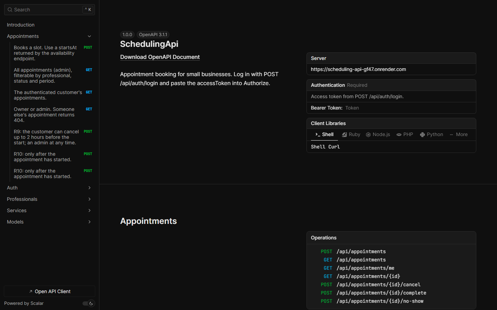

# SchedulingApi

[](https://github.com/EduardoCruz78/SchedulingApi/actions/workflows/ci.yml)


[](https://scheduling-api-gf47.onrender.com/scalar)

REST API for appointment booking in small businesses (barbershops, salons, clinics, studios), built with **ASP.NET Core 10, EF Core and PostgreSQL**.
It is not a CRUD: it computes free slots from working hours, time off and existing bookings, and **prevents double booking at the database level**, even under concurrent requests.

**Live demo:** <https://scheduling-api-gf47.onrender.com/scalar> (interactive API docs; demo credentials [below](#running-locally)).

> Hosted on Render's free plan: after 15 minutes without traffic the service sleeps, so the first request can take about 50 seconds. The database is PostgreSQL 17 on Neon.



## Features

- **Availability calculation**: free start times per professional, service and date, on a 15-minute grid, aware of split shifts, time off, lead-time rules and daylight saving time.
- **Booking with 13 business rules** (working hours, overlaps, time off, lead time, cancellation window, lifecycle...) and precise status codes: 400, 401, 403, 404, 409, 422, 429.
- **Double-booking prevention** with a PostgreSQL exclusion constraint, verified by a test that fires 10 concurrent bookings for the same slot and expects exactly one to succeed.
- **JWT authentication** with Admin and Customer roles; rate limiting on login and sign-up.
- **Catalog management**: services, professionals, weekly working hours and time off.
- **RFC 9457 ProblemDetails** for every error, with a stable error `code` and a `traceId`.
- **OpenAPI** document with an interactive **Scalar** UI.
- **Docker** image and `docker compose` stack; CI builds, tests and smoke-tests the container.

## Domain rules

| # | Rule | HTTP |
|---|---|---|
| R1 | The appointment fits inside the professional's working hours that day | 422 |
| R2 | No overlap with another appointment of the same professional (DB constraint) | 409 |
| R3 | A customer cannot have two overlapping appointments | 409 |
| R4 | Not during the professional's time off | 422 |
| R5 | At least 1 hour and at most 60 days in advance | 422 |
| R6 | Start times on a 15-minute grid | 422 |
| R7 | The professional performs the service; both are active | 422 |
| R8 | End = start + service duration; price copied at booking time | - |
| R9 | Customers cancel up to 2 hours before; admins any time | 422 |
| R10 | `Scheduled → Cancelled / Completed / NoShow`; final states never change | 422 |
| R11 | Working intervals of a day: start before end, no overlaps | 400 |
| R12 | Deactivated services leave the catalog; history stays valid | - |
| R13 | Time off cannot cover booked appointments | 409 |

Full details, error codes and the appointment lifecycle: [docs/domain-rules.md](docs/domain-rules.md).

## Architecture

Clean Architecture in four projects, with the dependency rule enforced by tests:

```
Api ──► Application ──► Domain
 │           ▲
 └──► Infrastructure
```

- **Domain**: aggregates (`Appointment`, `Professional`, `Service`, `User`), business rules, `Result`/`Error`. No dependencies.
- **Application**: use-case handlers, FluentValidation validators, the availability algorithm, ports (repositories, unit of work, token service).
- **Infrastructure**: EF Core + Npgsql, migrations, repositories, JWT issuing, password hashing, demo seeding.
- **Api**: controllers, ProblemDetails mapping, authentication, rate limiting, OpenAPI.

More in [docs/architecture.md](docs/architecture.md) and the [ADRs](docs/adr).

## Technical highlights

**Exclusion constraint against double booking** ([ADR 0003](docs/adr/0003-overlap-exclusion-constraint.md)). Checking for overlaps in code and then inserting is a race: two requests can pass the check before either inserts. The database closes that gap:

```sql
ALTER TABLE appointments ADD CONSTRAINT ex_appointments_professional_overlap
  EXCLUDE USING gist (
    professional_id WITH =,
    tstzrange(starts_at, ends_at, '[)') WITH &&
  ) WHERE (status <> 'Cancelled');
```

The application still checks first (friendly error in the common case); a `23P01` from PostgreSQL becomes the same `409 Appointment.SlotTaken`.

**Transactional Outbox** ([ADR 0005](docs/adr/0005-transactional-outbox.md)). Booking and cancelling raise domain events; the unit of work stores them in `outbox_messages` in the **same transaction** as the appointment. A background dispatcher publishes them to [WebhookRelay](https://github.com/EduardoCruz78/WebhookRelay) (portfolio project 2, an event delivery service) (`appointment.created`, `appointment.cancelled`), claiming rows with `FOR UPDATE SKIP LOCKED` so several instances can run it. If the relay is down, events wait in the table; if a send is repeated, the relay deduplicates it by id. No event is lost and none is published for an appointment that was rolled back. On the live demo, bookings are published to the [WebhookRelay demo](https://webhook-relay-1odf.onrender.com/docs).

**Availability as a pure function.** `AvailabilityCalculator` takes the professional, service, date, bookings, "now" and time zone, and returns UTC slots. No database, no clock, so every scenario is a millisecond unit test, including daylight saving transitions.

**Time zones** ([ADR 0004](docs/adr/0004-store-utc-business-timezone.md)). Instants are stored in UTC (`timestamptz`); working hours are local wall-clock times converted per date in the business time zone.

**`TimeProvider` everywhere.** Even JWT expiry is validated against the injected clock, so integration tests can move time forward and the whole app agrees on "now".

**Result pattern.** Expected failures are values with a typed `Error`; exceptions are for bugs. The error type maps to the HTTP status in one place.

**Optimistic concurrency** on appointments and professionals through PostgreSQL's `xmin` system column: no lost updates when an admin and a customer change the same appointment.

**No MediatR, AutoMapper or FluentAssertions** ([ADR 0002](docs/adr/0002-no-mediatr.md)). All three moved to commercial licenses in 2025. Handlers are plain classes injected by DI, mapping is explicit, and tests use the MIT-licensed AwesomeAssertions.

## Running locally

Requirements: Docker. Then:

```bash
docker compose up --build
```

Open <http://localhost:8080/scalar>. The API applies migrations and seeds demo data on startup.

| Role | E-mail | Password |
|---|---|---|
| Admin | `admin@scheduling.demo` | `Admin123!` |
| Customer | `maria@scheduling.demo` | `Customer123!` |
| Customer | `joao@scheduling.demo` | `Customer123!` |

These are fictitious demo credentials. In Scalar, call `POST /api/auth/login`, copy `accessToken` and paste it into **Authorize**.

Without Docker for the API (.NET 10 SDK and a PostgreSQL database):

```bash
dotnet user-secrets set "Jwt:Secret" "<at least 32 random characters>" --project src/Scheduling.Api
dotnet run --project src/Scheduling.Api
```

`appsettings.Development.json` points to the compose database on port 5433.

To publish appointment events, point the outbox at a WebhookRelay instance: `Outbox__RelayUrl` (base URL) and `Outbox__ApiKey` (a WebhookRelay source key). Without them, events are still stored in `outbox_messages` and published once the dispatcher is configured.

## Testing

```bash
dotnet test
```

**220 tests**, all run in CI on every push.

| Project | Tests | What it covers |
|---|---|---|
| `Scheduling.Domain.UnitTests` | 67 | Invariants, state transitions and domain events of every aggregate |
| `Scheduling.Application.UnitTests` | 52 | Availability algorithm (split shifts, time off, lead time, DST) and use cases with hand-written fakes |
| `Scheduling.Api.IntegrationTests` | 101 | Every endpoint and status code over HTTP, migrations from scratch, the exclusion constraint, optimistic concurrency, JWT expiry, rate limiting, the 10-way concurrent booking race, the outbox (atomic writes, publishing, relay outages, concurrent dispatchers) and the webhook signature contract with [WebhookRelay](https://github.com/EduardoCruz78/WebhookRelay/blob/main/docs/webhook-signature.md) |

Integration tests start a real PostgreSQL 17 with Testcontainers (Docker required). To use an existing server instead, set `SCHEDULING_TEST_DB` to a connection string for an **empty, dedicated** database (tests truncate every table).

## API overview

All routes are under `/api`. Lists accept `?page=&pageSize=` and return `{ items, page, pageSize, totalCount }`.

| Method | Route | Access |
|---|---|---|
| POST | `/auth/register` | public |
| POST | `/auth/login` | public |
| GET | `/auth/me` | authenticated |
| GET | `/services` · `/services/{id}` | public |
| POST · PUT · DELETE | `/services` · `/services/{id}` | admin |
| GET | `/professionals?serviceId=` · `/professionals/{id}` | public |
| POST · PUT | `/professionals` · `/professionals/{id}` | admin |
| PUT | `/professionals/{id}/services` · `/professionals/{id}/working-hours` | admin |
| POST · DELETE | `/professionals/{id}/time-off` · `/professionals/{id}/time-off/{timeOffId}` | admin |
| GET | `/professionals/{id}/availability?serviceId=&date=` | public |
| POST | `/appointments` | customer |
| GET | `/appointments/me?status=&from=&to=` | customer |
| GET | `/appointments?professionalId=&status=&from=&to=` | admin |
| GET | `/appointments/{id}` | owner or admin |
| POST | `/appointments/{id}/cancel` | owner or admin |
| POST | `/appointments/{id}/complete` · `/appointments/{id}/no-show` | admin |

Plus `GET /health` (database check), `GET /openapi/v1.json` and `GET /scalar`.

## Roadmap

- **Multi-tenancy**: a `tenant_id` on every table (and in the exclusion constraint), the time zone moved onto the tenant, tenant resolved from the token.
- Delete processed outbox rows after a retention period.
- **Admin dashboard** in Next.js (portfolio project 3), consuming this API (CORS is already configurable).
- Migration bundle in the deployment pipeline instead of migrating on startup.

## License

[MIT](LICENSE)

<details>
<summary>🇧🇷 Em português</summary>

**SchedulingApi** é uma API REST de agendamentos para pequenos negócios (barbearias, salões, clínicas), feita em **ASP.NET Core 10, EF Core e PostgreSQL**.

- Calcula os horários livres de cada profissional a partir do expediente, das folgas e dos agendamentos existentes, respeitando fuso horário e horário de verão.
- Impede agendamento duplo **no próprio banco de dados**, com uma *exclusion constraint* do PostgreSQL. Um teste dispara 10 reservas simultâneas para o mesmo horário e exige que só uma seja aceita.
- Tem 13 regras de negócio documentadas, autenticação JWT com papéis (Admin e Cliente), rate limiting e erros padronizados (ProblemDetails).
- Segue Clean Architecture e DDD, com testes unitários e de integração com PostgreSQL real (Testcontainers), Docker e CI no GitHub Actions.

Demo online: <https://scheduling-api-gf47.onrender.com/scalar>, que publica os eventos de agendamento na [demo do WebhookRelay](https://webhook-relay-1odf.onrender.com/docs) (plano gratuito: a primeira requisição depois de um tempo parado pode levar uns 50 segundos).

Para rodar localmente: `docker compose up --build` e abrir <http://localhost:8080/scalar>.

</details>
